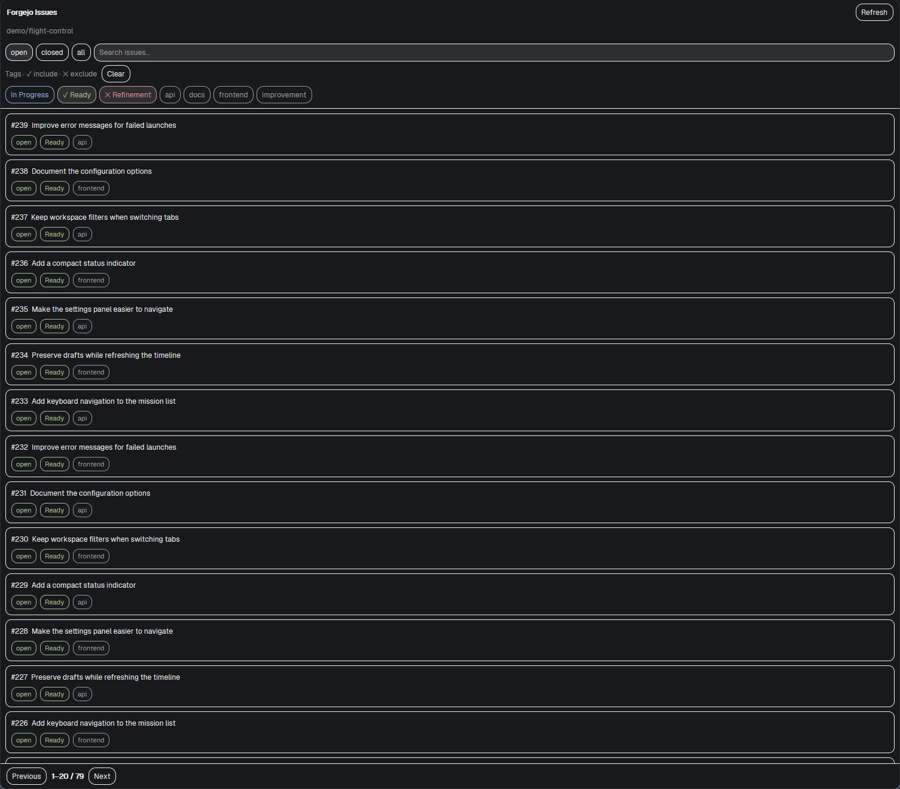
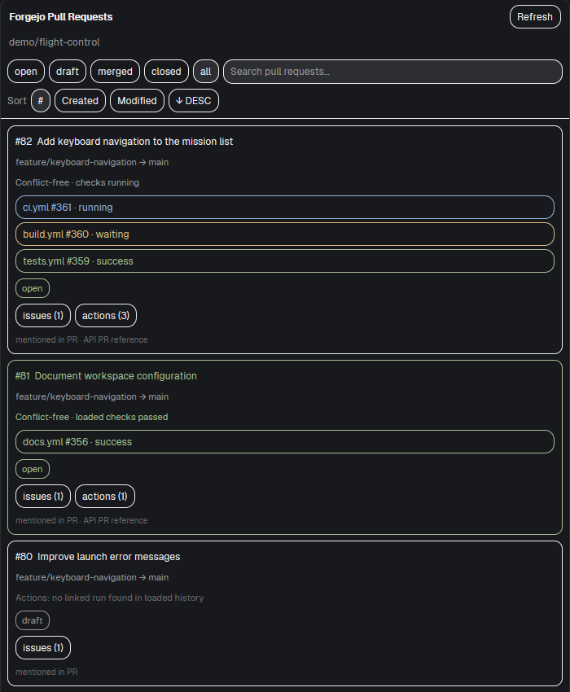
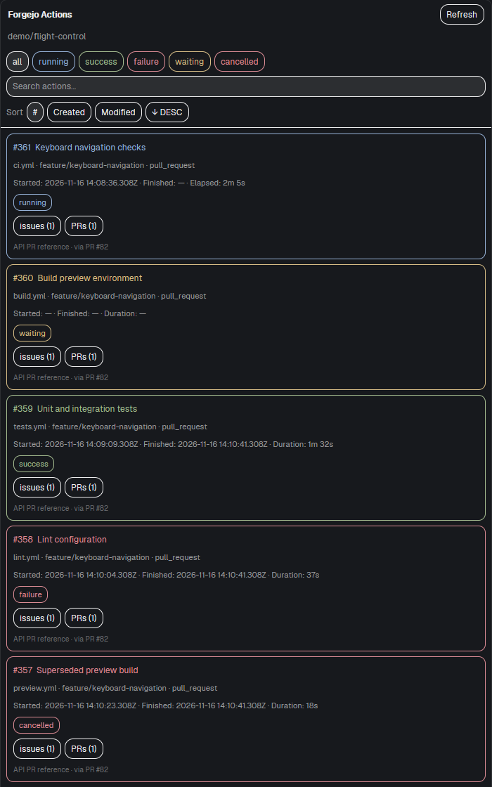

# Herdr Forgejo

A compact, read-only Forgejo browser for Herdr's side panel, with separate Issues, Pull Requests and Actions mods.



## Three linked views

| View | What it shows | Filters |
| --- | --- | --- |
| **Issues** | Repository-wide issues, labels and assignees | Open/closed/all, text search, include/exclude labels |
| **Pull Requests** | PR state, source/target branches, conflict status and attached Actions | Open/draft/merged/closed/all and text search |
| **Actions** | Workflow runs, refs, status, start/finish times and duration | Multiple statuses together and text search |

All views follow the focused terminal, support worktrees and remote Unix spaces, and use the base checkout's credentials. Sort by number, Created or Modified in ASC/DESC order. Sorting applies before pagination; the compact footer shows ranges such as 1–20 / 79.

### Issues

Click a label to cycle **✓ include → ✕ exclude → unfiltered**. Multiple filters combine: require all included labels and reject every excluded label. Ready is green, In Progress blue and Refinement red. Label badges and filters appear only in Issues.

### Pull Requests



PR cards show branch direction and up to six recent attached workflow runs, each with its colored status. Clicking a run opens that specific item in Actions. Recent runs are fetched with the initial PR list, so badges need not wait for the complete history lookup.

An open PR turns green only when Forgejo reports no merge conflicts and the latest loaded run for each attached workflow has succeeded or been skipped. Running, waiting, failed, cancelled or unknown CI keeps the card neutral. The status distinguishes **Conflict-free · checks running** from **Conflict-free · loaded checks passed**. This summarizes loaded checks; it does not evaluate every branch-protection rule, required review or merge permission.

### Actions



Select several statuses at once—for example **running + success + waiting**. Matches combine with OR; **All** clears the selection. Search has its own line.

- **Blue:** running/in progress.
- **Green:** success.
- **Red:** failed, cancelled or blocked.
- **Yellow:** waiting/queued.

Each run shows started and finished timestamps in **UTC**, plus duration or running elapsed time. Timing uses one line on wide panels; on narrower panels, duration starts the second line. Runner names and labels are not displayed: the tested server's run API omits assignments and its runner/job endpoints deny the current token.

### Navigate related work

Related-item buttons switch between Issues, PRs and Actions and filter to the linked records. **Clear link** returns to normal browsing. Clicking an ordinary card opens it in your browser. All views are read-only: no issue edits, PR merges or workflow reruns/cancellations.

## Requirements

Herdr app 0.1.16 or newer, Git, and Python 3.10+ (`python` on Windows, `python3` on macOS/Linux and remote Unix machines). The local Windows runtime and remote Unix loading have been exercised during development; macOS/Linux browser opening uses platform commands but has not been live-tested.

## Configuration

In the **base checkout**, create a Git-ignored `.env`:

```dotenv
FORGEJO_TOKEN=your-read-only-token
# Optional: inferred from the Git remote when absent
FORGEJO_URL=https://forge.example
# Optional: select a remote other than origin
FORGEJO_REMOTE=origin
```

Use a token with read access to the repository, issues, pull requests, labels and Actions. The URL must use HTTPS; supply it for SSH host aliases or a reverse-proxy base path. Remote machines read their own base checkout's `.env`. GitHub/GitLab/Bitbucket remotes are rejected when they conflict with the configured Forgejo host.

## Install with your agent

Ask your agent to read `RECIPE.md`, inspect the mod files, and install all three folders into your Herdr app home: `mods/forgejo-issues`, `mods/forgejo-prs` and `mods/forgejo-actions`. Add Issues, PRs and Actions blocks and buttons beside Files and Changes. Preserve your existing layout and mods by cloning shipped files before editing. The recipe gives the integration details.

Each view also works in a standalone pane:

```sh
herdr-app do pane.split --direction right --mod forgejo-issues
herdr-app do pane.split --direction right --mod forgejo-prs
herdr-app do pane.split --direction right --mod forgejo-actions
```

For the full suite, install all three folders under `mods/` and add panel blocks and toggles for `forgejo-issues`, `forgejo-prs` and `forgejo-actions`. Each companion mod is self-contained. No full layout or custom editor is bundled. Existing mods with the same name must be renamed or backed up before installation.

## Linking and limits

PR title/body references to existing issues create bidirectional links, labelled “mentioned in PR”; these do not claim a closing relationship. Runs link to PRs through API event metadata or an exact head/merge commit match. Issue-to-run links are then derived through that PR. Branch name similarity never creates links. Foreign-repository references are not treated as local issue numbers. Timeline-only and comment-only references are not currently indexed.

Links cover fetched records only: at most 5,000 issues, 5,000 PRs and the latest 500 runs. The footer shows `+` when that panel's result limit is reached. Some older servers or tokens cannot list Actions; partial failures are shown while the other data stays usable. Separate datasets fetch in parallel. No merge/rerun/cancel buttons are provided.

Initial loading first shows up to 100 recently updated items from the selected panel. History and links load separately in the background. Until that finishes, sorting/filtering covers the initial subset and the footer shows `+`. A failed or timed-out history lookup keeps the loaded list, shows an error and waits for manual Refresh instead of restarting on every redraw.

## Access and storage

The mod runs Git and a Python helper, reads `.env` outside its own folder, and makes authenticated read-only HTTPS requests to Forgejo. Remote execution goes through Herdr. Credentials stay inside the helper, are not passed in command arguments, and are not printed or cached. HTTP redirects are refused. Fetched issue, PR and run data is cached in memory only. Browsing launches the local default browser; no issues are edited or posted.

A refresh failure can display cached results. Tokens with missing permissions, absent Python, offline machines and non-Git folders produce an error in the panel. The token also needs read access to Actions to populate the workflow panel.

## Development

```sh
python -m unittest discover -s tests
herdr-app check mods/forgejo-issues
herdr-app check mods/forgejo-prs
herdr-app check mods/forgejo-actions
```

Run `python sync_panels.py` after modifying the shared Issues view or backend; it regenerates the self-contained companion copies.

License: MIT. UI editing workflow was inspired by community Herdr mods; this package contains only the three Forgejo mods, with no copied tab-bar code or icons.
