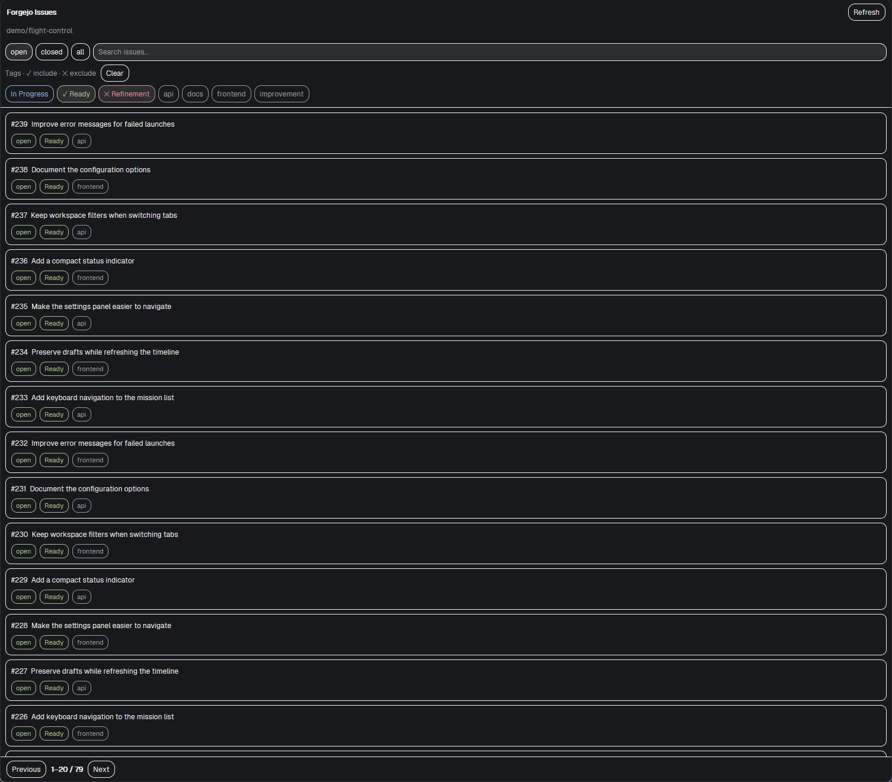

# Forgejo Issues

A compact repository-wide Forgejo issue list beside Herdr's Files and Changes. Search, state and tag filters stay above a scrolling list of outlined issue cards, with a compact range footer below.

The suite also includes `mods/forgejo-prs` and `mods/forgejo-actions`, sharing the same view and credential rules. Add their blocks/toggles beside Issues; include their IDs in tab-bar panel persistence. PR cards show branch direction and open/draft/merged/closed status. Action cards show workflow, ref and run state. Each card groups links to the other panels with counts. Clicking a group switches panels and shows items linked back to that source, clearing text/tag/status filters; Clear link restores normal browsing. Show link provenance (PR mention, API PR reference, exact commit, or via PR). Links cover loaded records only; do not infer relationships from similar branch names. All operations remain read-only. Companion mod recipes describe installation independently.

## What you see

Top to bottom: a 42px title row with Refresh, repository name, one row of rounded Open/Closed/All buttons and a compact rounded search input, then naturally wrapping outlined tag pills. The issue list has fixed 1px foreground separators above and below it. Each card has a 10px corner radius, foreground border and title, and wrapped label pills. Ready is green, In Progress blue and Refinement red using the theme's ANSI colors; other tags use muted text. The footer shows Previous, a range such as `1–20 / 79`, and Next. The screenshot uses synthetic demo issues.

## How it behaves

Always show repository-wide issues; branch names never restrict issues. Search covers number, title, labels and assignees. Sort controls choose number, Created or Modified plus ASC/DESC, defaulting to Modified DESC. Sort all filtered issues before slicing the page and reset to page one when sort changes; compare dates as timestamps and break ties by issue number. Tag clicks cycle neutral → include (✓) → exclude (✕) → neutral; combine all requirements. Clear removes tag filters. Issue badges toggle filters without opening the browser; clicking a card opens its Forgejo page. Refresh every 30 seconds while the side panel is visible; preserve cached data on a failed refresh. Fetching is read-only. There is no special display for agent working/blocked/done/idle states.

## Built from

One JavaScript native GPUI mod at `mods/forgejo-issues/main.js`, metadata `mod.json`, and Python standard-library adapter `backend.py`. Use retained InputState for search and Herdr's theme, focused terminal, panes, spaces, exec, readTextFile and appHome APIs. The Python helper reads Git's common directory to find the base `.env`, infers host/owner/repository from origin or FORGEJO_REMOTE, and uses authenticated HTTPS GET calls for paginated issues and repository labels. Cache sanitized issue data per host/repository in module memory.

Install the mod under the person's app home; check their installed AGENTS.md and `.d.ts` files first. Clone their shipped layout before structural changes. Add a block with id `forgejo-issues` and content `{"mod":"forgejo-issues"}` to their existing `panel-body` stack. Add an Issues toggle to a personal tab-bar copy, or add a block with `{"mod":"forgejo-issues","props":{"button":true}}` beside it. The button toggles `panel` and selects the child in `panel-body`. If a tab bar remembers allowed panels, include `forgejo-issues` in that list. Adapt these IDs if their layout uses other names. Standalone panes also work; manual Refresh is available there.

## Watch out

Requires Python 3.10+ and Git on the repository's machine. Local Windows uses python; Unix uses python3. No Node or browser DOM. Remote helper source is passed to python3 through Herdr, while credentials are read on the remote host. Never copy tokens into mod state, arguments, screenshots or logs. HTTPS redirects are refused. Do not eagerly build all issue cards: render 20 per page to stay within Herdr's script budget. Keep dividers outside the scroll area and do not give the tag row a fixed/minimum height. No API mutations, PR editing, branch mode, secret persistence or automatic issue creation.

## Done when

Herdr checks pass; the panel renders empty and populated lists; search and all three tag states combine correctly; pagination shows the actual issue range; switching worktrees shares the base credentials and repository cache; external GitHub remotes do not receive Forgejo credentials; offline failures show readable errors; the user's existing Files/Changes panels still work.
